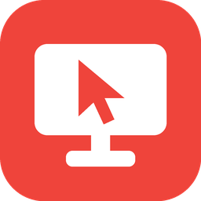

# OpenDesk 2 — remote desktop for Windows

A single `OpenDesk.exe`. Run it on both PCs; no server to host, no port forwarding, no browser.
Build it yourself (see the end of this page) or download it from this repository's Releases page.

## Use

1. Start `OpenDesk.exe` on both PCs. Each shows a permanent 9-digit **address**.
2. On the controlling PC, type the other PC's address and press **Connect**.
3. On the other PC, press **Accept** (and choose what to allow), **or** set an unattended-access
   password there once and log in with it from anywhere.

In a session: remote keyboard/mouse, display and quality selection, view modes, fullscreen, file
transfer in both directions (**Files**), clipboard text sync, chat, screenshots, special keys (**Actions…**).

Moving files, quickest first:

- **Copy and paste:** select files or folders, Ctrl+C on one PC, Ctrl+V on the other (either direction;
  up to 2,000 files / 2 GB per copy). Needs both the clipboard and files permissions.
- **Drag and drop:** drag files onto the remote screen; they land on the remote Desktop.
- **Files window:** browse both PCs side by side; double-click a file to transfer it.

## Android

`OpenDesk.apk` controls a PC from a phone or tablet (Android 7 or newer). Copy it to the device, open
it and allow "install unknown apps" when asked. Enter the PC's address and connect as above.

- **Touch:** tap = click · hold = right click · double-tap and drag = drag · two fingers = scroll ·
  pinch = zoom (keep both fingers down to move the view).
- **Keyboard:** the *Keyboard* button opens the on-screen keyboard with an extra row (Esc, Tab, Ctrl, Alt, arrows…).
- **Files:** *Files* → *Send files from this device…*, or select remote files and *Save selected here*
  (saved to `Download/OpenDesk`). Clipboard text is shared; copying files through the clipboard is not.
- The Android app cannot be controlled from another device, and the session ends if the app is
  left in the background for long.

## How it connects across networks

- **Finding each other:** both apps keep an outbound WebSocket to public MQTT brokers (three by
  default, used in parallel) and exchange the connection handshake there. Only the handshake goes
  through them — no screen data, files or passwords.
- **The session itself:** a direct, DTLS-encrypted WebRTC data channel between the two PCs, opened
  with NAT hole punching (STUN). The password login is bound to the DTLS certificates of both ends.
- **When direct fails:** some mobile, hotel and corporate networks block hole punching. The app says
  so; add a TURN relay on both PCs under *Settings → Connection*, e.g. `turn:host:3478 user secret`.

## Settings

*General* (name, start with Windows) · *Security* (accept prompts, unattended password, permissions) ·
*Display* (quality, view mode, remote cursor) · *Connection* (rendezvous + STUN/TURN servers).
Stored in `%APPDATA%\OpenDesk\config.json`; log in `opendesk.log` next to it.

## Limits

- Windows only. Cannot type into elevated (admin) windows or the UAC / lock screen unless OpenDesk
  itself is run as administrator; Ctrl+Alt+Del cannot be sent.
- No audio, no folder transfer (files only), no session recording.
- Closing the window quits the app (the PC is then unreachable).

## Develop / build

Requires Windows 10/11 and Python 3.12.

```
pip install -r requirements.txt
python server.py                      # run from source
pyinstaller --noconfirm OpenDesk.spec # build dist\OpenDesk.exe
python server.py --profile b --headless --port 5612   # second test desk; URL is printed
```

Android: `python android/build_apk.py` builds `dist\OpenDesk.apk` (needs a JDK and the Android SDK
build-tools; no Gradle). `android/web/mobile.js` replaces the Windows backend inside the app's WebView and
adds touch input; the rest of the UI is the same `public/` folder. The first build creates
`android/opendesk.keystore` — keep it, since updates only install over a copy signed with the same key.

`server.py` is the native backend (capture, input, files, clipboard, settings) bound to 127.0.0.1;
`public/` is the UI and network layer shown in the app window.
